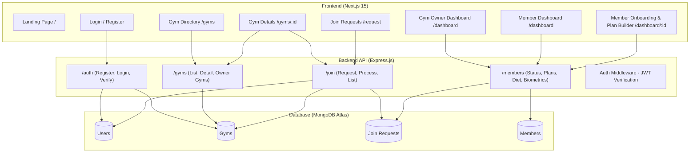

# FitConnect — System Context & Architecture Documentation

## 1. Executive Summary

**FitConnect** is a full-stack gym and fitness management platform designed to bridge the gap between gym owners and fitness enthusiasts (members). It streamlines gym discovery, membership acquisition, member onboarding, workout routine design, diet tracking, and physical biometric measurements within a unified web portal.

---

## 2. Technology Stack

### Frontend
- **Framework**: [Next.js 15](https://nextjs.org/) (App Router, React 19)
- **Styling**: Tailwind CSS, PostCSS, Radix UI primitives (`@radix-ui/react-*`), Headless UI
- **Icons**: Lucide React, React Icons
- **Data Visualization**: Recharts
- **State & Auth**: React Context API (`AuthContext`), JWT client-side persistence

### Backend
- **Runtime & Framework**: Node.js & Express.js
- **Database & ODM**: MongoDB with Mongoose
- **Authentication & Security**: JSON Web Tokens (JWT), bcryptjs for password hashing, CORS middleware
- **Deployment Targets**: Vercel serverless configurations for both frontend and backend

---

## 3. User Roles & Capabilities

| Role | Description | Core Capabilities |
| :--- | :--- | :--- |
| **`member`** | Fitness Enthusiast | • Discover available gyms and view gym amenities, hours, and membership plans.<br>• Submit join requests to gyms and monitor request status.<br>• View active membership status, duration, and assigned plans.<br>• Access daily customized workout routines (exercises, sets, reps, weights, notes).<br>• Access customized diet plans and macro breakdowns.<br>• View body measurements and physical progress tracking. |
| **`gymOwner`** | Gym Manager / Owner | • Register gym profiles including facilities, operating hours, amenities, and pricing plans.<br>• Receive, review, approve, or reject incoming member join requests.<br>• Onboard approved members with a multi-step setup form.<br>• Assign and update membership plans (duration, validity, price).<br>• Create and assign weekly workout routines tailored to specific muscle groups.<br>• Build and assign daily nutrition/diet meal plans.<br>• Log and update member biometrics and physical measurements.<br>• Manage member status (`active`, `inactive`, `suspended`). |
| **`admin`** | System Administrator | • Global administrative access for system oversight and member moderation. |

---

## 4. Architecture & Data Flow



---

## 5. End-to-End User Journeys

### 5.1 Registration & Gym Setup
1. **Gym Owner Registration**: The user selects "Gym Owner" role, completes personal credentials, and fills out gym details:
   - Gym name, address (street, city, state, zip), contact details (phone, email).
   - Amenities (Cardio, Weight Training, Group Classes, Pool, Sauna, Locker Rooms, Personal Training).
   - Operating hours (open time, close time, open days).
   - Membership plans (name, duration: Monthly/Quarterly/Annual, price).
2. **Member Registration**: Standard user registration with name, email, password, and default role `member`.

### 5.2 Join Request Lifecycle
1. Member navigates to `/gyms` and browses available gym listings.
2. Member inspects gym amenities, operating hours, and plans at `/gyms/[id]`.
3. Member clicks **"Join Gym"**, generating a `Join` record with status `pending`.
4. Gym Owner checks `/request` to see pending applications.
5. Gym Owner approves or rejects the request:
   - When approved, owner is routed to `/dashboard/[id]` (using the `joinRequestId`) to configure initial membership plans, health information, body measurements, and workout plans.
   - The member's user profile is updated with the gym's ID.

### 5.3 Member Management & Fitness Plans
1. Gym Owner manages all gym members via `/dashboard`.
2. For each member, the gym owner can update:
   - **Membership Plan**: Start/end dates, pricing, plan tier.
   - **Health Info**: Medical conditions, allergies, blood group.
   - **Body Measurements**: Height, weight, BMI, body fat %, chest, waist, hips, biceps, thighs.
   - **Exercise Routine**: Day-by-day (Monday to Saturday) routine selecting valid exercises grouped by muscle categories (Chest, Back, Shoulders, Legs, Arms, Core, Cardio) along with sets, reps, weight, duration, and rest times.
   - **Diet Plan**: Day-by-day meal schedule (Breakfast, Lunch, Dinner, Snack) with itemized calorie, protein, carb, and fat breakdowns.
3. Member logs in and sees their personalized dashboard with their current plan, assigned workouts, and diet recommendations.

---

## 6. Project Directory Structure

```
gym_application/
├── docs/
│   └── context.md                 # System overview and architecture (this file)
├── backend/
│   ├── controller/
│   │   ├── authController.js       # Handles registration, login, and JWT verification
│   │   ├── gymController.js        # Gym listing, detail lookup, and owner query
│   │   ├── joinController.js       # Join request creation, processing, and retrieval
│   │   └── memberController.js     # Member profile CRUD, workout, diet, and measurement handling
│   ├── middleware/
│   │   └── authMiddleware.js       # JWT authorization guard for protected routes
│   ├── models/
│   │   ├── ExcerciseCategories.js  # Standard exercise catalog mapped to muscle groups
│   │   ├── GymSchema.js            # Gym profile schema
│   │   ├── joinSchema.js           # Membership join request schema
│   │   ├── Member.js               # Member schema (health info, measurements, workouts, diet)
│   │   └── User.js                 # Base user credentials & role definition
│   ├── routes/
│   │   ├── authRoutes.js           # /auth routes
│   │   ├── gymRoutes.js            # /gyms routes
│   │   ├── joinRoutes.js           # /join routes
│   │   └── memberRoutes.js         # /members routes
│   ├── .env                        # Backend environment configuration (PORT, MONGO_URI, JWT_SECRET)
│   ├── package.json
│   ├── server.js                   # Express server bootstrap, DB connection & route mounting
│   └── vercel.json                 # Vercel deployment configuration for API
└── frontend/
    ├── app/
    │   ├── dashboard/
    │   │   ├── [id]/
    │   │   │   └── page.jsx        # Multi-step member onboarding & plan assignment form
    │   │   └── page.jsx            # Role-aware dashboard (gym members table vs member stats)
    │   ├── gyms/
    │   │   ├── [id]/
    │   │   │   └── page.jsx        # Detailed gym profile, amenities, and plans view
    │   │   └── page.jsx            # Gyms catalog with join request triggers
    │   ├── login/
    │   │   └── page.jsx            # User sign-in interface
    │   ├── register/
    │   │   └── page.jsx            # Multi-step registration for members and gym owners
    │   ├── request/
    │   │   └── page.jsx            # Join request approval/rejection interface for owners
    │   ├── globals.css             # Tailwind base styles and theme definitions
    │   ├── layout.js               # Root layout wrapping application with AuthProvider & Header
    │   └── page.js                 # Public landing page with features overview
    ├── components/
    │   ├── ui/                     # Reusable shadcn/Radix UI components (card, button, tabs, etc.)
    │   ├── BodyMeasurements.jsx    # Visual display component for biometric metrics
    │   ├── ExercisePlan.jsx        # Weekly workout viewer component
    │   ├── Header.jsx              # Global navigation bar with role-sensitive links
    │   ├── MemberDetails.jsx       # Member summary details card
    │   └── MembershipPlanForm.js   # Modular sub-forms (Health, Measurements, Plan, Exercises)
    ├── constants/
    │   └── ExerciseCategories.js   # Frontend reference list for exercise-to-muscle group mapping
    ├── contexts/
    │   └── AuthContext.js          # Authentication context handling token storage, login/logout, roles
    ├── .env                        # Frontend environment variables (NEXT_PUBLIC_API_URL)
    ├── package.json
    ├── tailwind.config.mjs
    └── vercel.json                 # Vercel deployment configuration for Next.js app
```

---

## 7. Database Schemas

### 7.1 User (`backend/models/User.js`)
- `name` (String, required)
- `email` (String, required, unique)
- `password` (String, required, hashed)
- `role` (String, enum: `["member", "admin", "gymOwner"]`, default: `"user"`)
- `gymId` (ObjectId, ref: `"Gym"`, default: null)
- `timestamps` (createdAt, updatedAt)

### 7.2 Gym (`backend/models/GymSchema.js`)
- `name` (String, required)
- `owner` (ObjectId, ref: `"User"`, required)
- `address`: `{ street, city, state, zipCode }`
- `contact`: `{ phone, email }`
- `amenities`: Array of enum values (`"Cardio Equipment"`, `"Weight Training"`, `"Group Classes"`, `"Swimming Pool"`, `"Sauna"`, `"Locker Rooms"`, `"Personal Training"`)
- `operatingHours`: `{ openTime, closeTime, daysOpen: [String] }`
- `memberShipPlans`: Array of `{ name, price, duration: ["Monthly", "Quarterly", "Annual"] }`
- `isActive` (Boolean, default: true)
- `timestamps` (createdAt, updatedAt)

### 7.3 Join (`backend/models/joinSchema.js`)
- `member` (ObjectId, ref: `"User"`, required)
- `gym` (ObjectId, ref: `"Gym"`, required)
- `status` (String, enum: `["pending", "approved", "rejected"]`, default: `"pending"`)

### 7.4 Member (`backend/models/Member.js`)
- `joinRequestId` (ObjectId, ref: `"JoinRequest"`, required, unique)
- `user` (ObjectId, ref: `"User"`, required)
- `gym` (ObjectId, ref: `"Gym"`, required)
- `memberShipPlan`: `{ name, duration, startDate, endDate, price }`
- `status`: enum `["active", "inactive", "suspended"]`, default: `"active"`
- `paymentStatus`: enum `["paid", "pending", "failed"]`, default: `"pending"`
- `healthInfo`: `{ medicalConditions: [String], allergies: [String], bloodGroup: String }`
- `measurements`: `{ date, weight, height, chest, waist, hips, biceps, thighs, bodyFatPercentage, bmi }`
- `exercisePlan`: Workouts mapped by day (`Monday` through `Saturday`):
  - Each day contains `exercises: [{ name, muscleGroup, sets, reps, weight, duration, restBetweenSets, notes, progression }]`, `notes`, `duration`
- `dietPlan`: Array of daily diet objects with `meals: [{ type, time, items: [{ name, quantity, calories, proteins, carbs, fats }] }]`
- `timestamps` (createdAt, updatedAt)

---

## 8. API Reference

### Auth Routes (`/auth`)
| Method | Endpoint | Auth Required | Description |
| :--- | :--- | :--- | :--- |
| `POST` | `/auth/register` | No | Registers a new user (`member` or `gymOwner` with nested gym creation). |
| `POST` | `/auth/login` | No | Validates credentials and returns JWT token and user profile. |

### Gym Routes (`/gyms`)
| Method | Endpoint | Auth Required | Description |
| :--- | :--- | :--- | :--- |
| `GET` | `/gyms` | No | Returns list of all active gyms. |
| `GET` | `/gyms/:id` | No | Returns details for a specific gym by ID. |
| `GET` | `/gyms/owner/:userId` | Yes | Returns gym(s) owned by the specified user ID. |

### Join Request Routes (`/join`)
| Method | Endpoint | Auth Required | Description |
| :--- | :--- | :--- | :--- |
| `POST` | `/join/request` | Yes (Member) | Submits a join request to a gym. |
| `POST` | `/join/process` | Yes (Owner) | Approves or rejects a join request (`status: "approved"` / `"rejected"`). |
| `GET` | `/join/requests` | Yes | Fetches join requests (filtered by member or gym owner based on role). |

### Member Management Routes (`/members`)
| Method | Endpoint | Auth Required | Description |
| :--- | :--- | :--- | :--- |
| `POST` | `/members/add` | Yes (Owner) | Creates or updates a full member profile linked to a join request. |
| `GET` | `/members/gym-members` | Yes (Owner) | Fetches all active members belonging to the owner's gym. |
| `GET` | `/members/status` | Yes (Member) | Fetches current user's membership and workout status. |
| `GET` | `/members/by-join-request/:joinRequestId` | Yes | Fetches member profile details using the original join request ID. |
| `GET` | `/members/by-user/:userId` | Yes (Owner) | Fetches member profile by member's user ID. |
| `GET` | `/members/exercise-categories` | Yes | Returns valid muscle groups and exercise library. |
| `PUT` | `/members/update-status` | Yes (Owner) | Updates member status (`active`, `inactive`, `suspended`). |
| `PUT` | `/members/exercise-plan` | Yes (Owner) | Updates weekly workout routines for a member. |
| `PUT` | `/members/diet-plan` | Yes (Owner) | Updates daily diet and nutritional plan for a member. |
| `PUT` | `/members/measurements` | Yes (Owner) | Appends a new set of biometric measurements for a member. |
| `GET` | `/members/:id` | Yes (Owner) | Fetches member by member document ID. |

---

## 9. Environment Configuration

### Backend (`backend/.env`)
```env
PORT=5000
MONGO_URI=<mongodb_connection_string>
JWT_SECRET=<secret_key_for_signing_jwt>
```

### Frontend (`frontend/.env`)
```env
NEXT_PUBLIC_API_URL=http://localhost:5000
```
*(In production, points to the deployed backend URL).*
